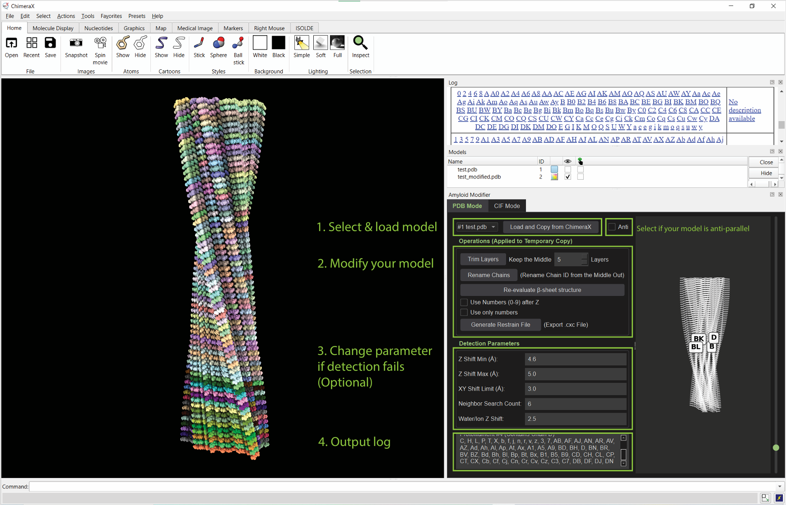
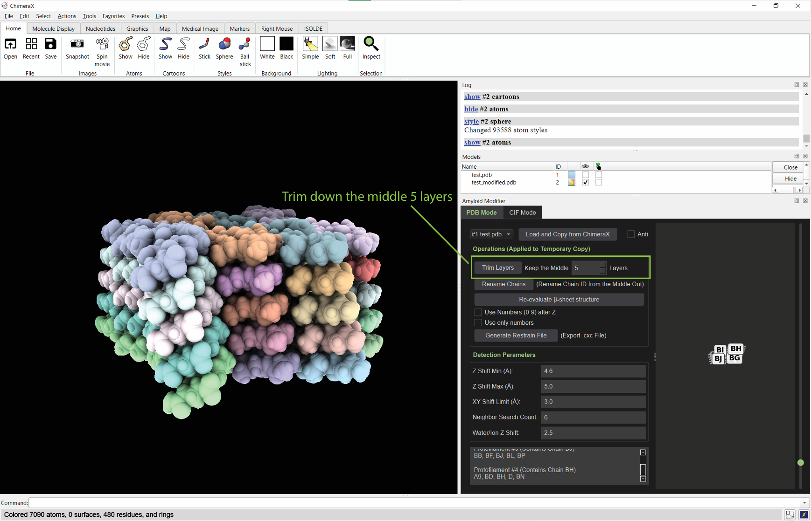
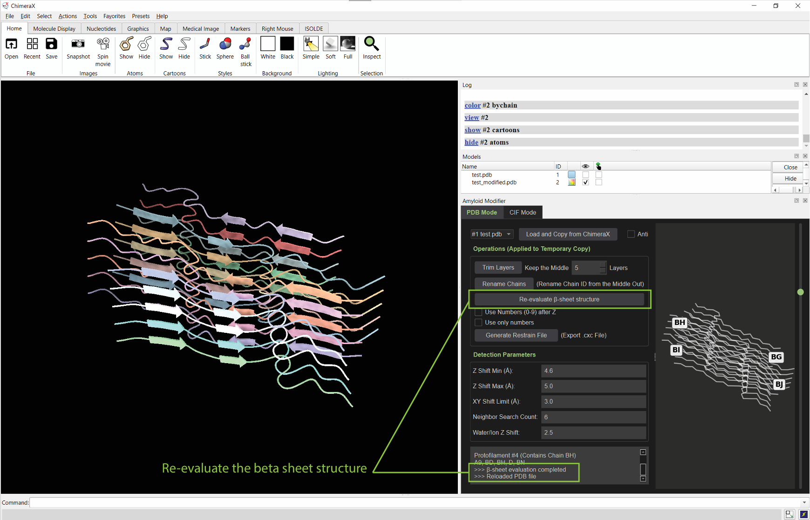
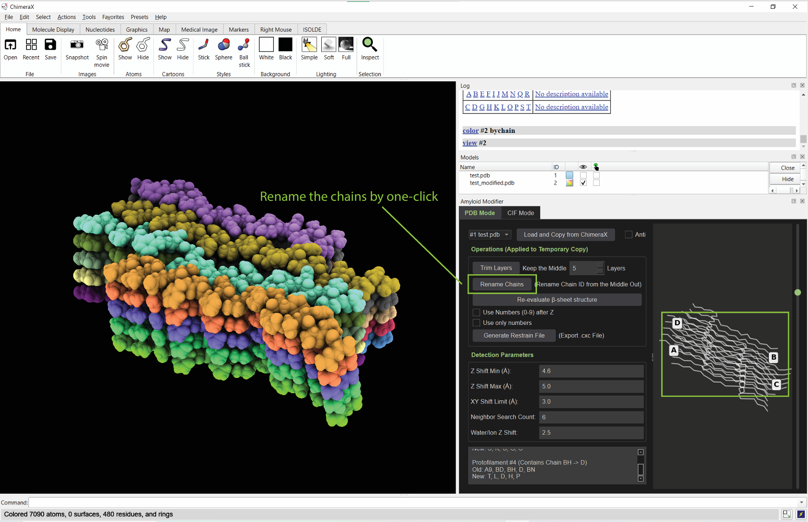
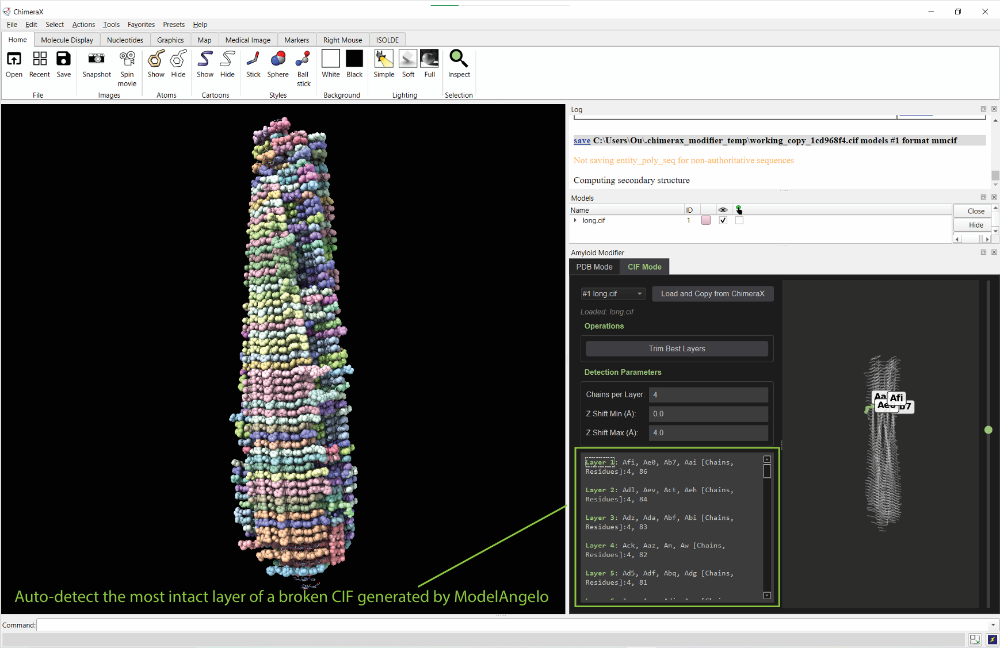
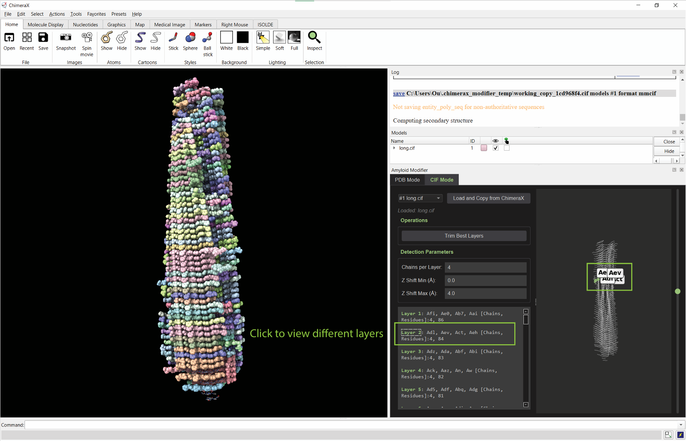
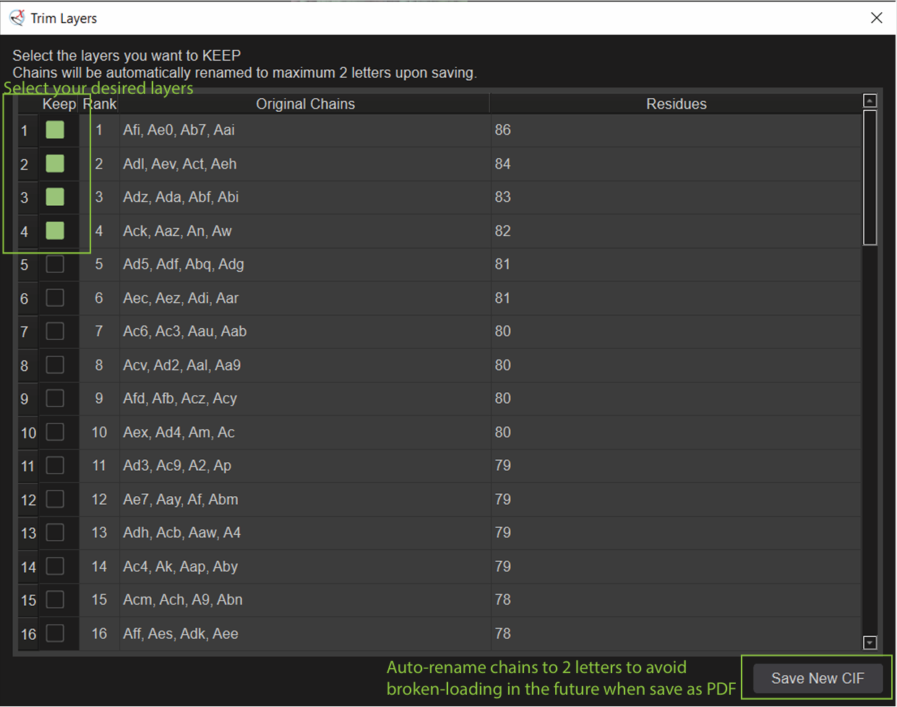
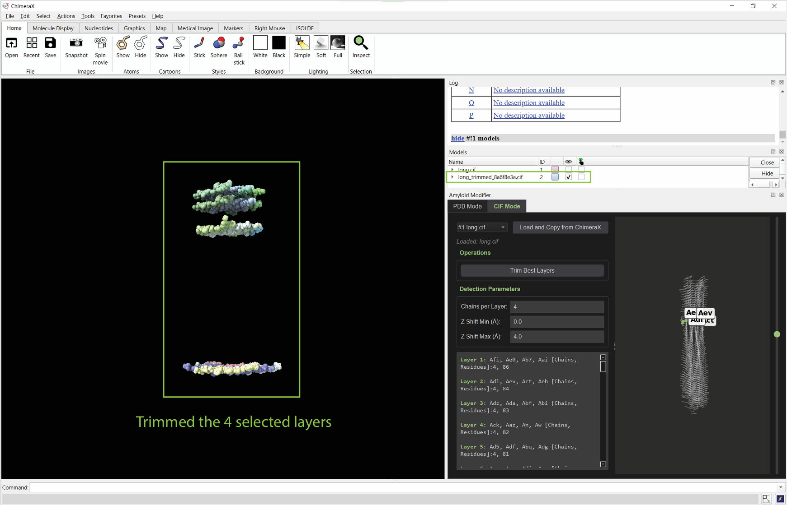

# Amyloid Modifier for ChimeraX

**Amyloid Modifier** is an okay-ish powerful, interactive ChimeraX tool designed specifically for structural biologists and cryo-EM researchers to build multi-layer amyloid models.

Processing amyloid models often involves tedious manual labor: fixing broken chain IDs, trimming ragged fibril ends to create clean publishable models, and setting up complex restraints for molecular dynamics or ISOLDE refinement. Amyloid Modifier automates this entire workflow in a unified, user-friendly GUI.

## Key Features

- **Intelligent Layer Detection:** Automatically detects protofilaments and horizontal layers using customizable spatial parameters (Z-Shift and XY-Shift limits), supporting both parallel and anti-parallel amyloid arrangements.
- **Automated Trimming/Expanding:** Easily trim/expand your fibril to a specific number of central layers. The tool intelligently retains associated waters and ions while discarding ragged edges.
- **Smart Chain Renaming:** Systematically rename chains from the middle out (e.g., A, B, C... or 0, 1, 2...) to ensure standardized nomenclature. Automatically resolves duplicate or broken chain IDs.
- **ISOLDE Restraint Generation:** Export a `.cxc` command file to apply ISOLDE torsion restraints. It automatically restrains the outer layers of the fibril using the central layer as a structural template.
- **Secondary Structure Re-evaluation:** Seamlessly triggers ChimeraX's built-in `dssp` algorithm to recalculate and annotate β-sheet as you click
- **PDB & mmCIF Support:** PDB is typically for trimming and renaming the model; CIF is for trimming the best layers from a broken model generated by ModelAngelo.

## Quick Start Guide

1. **Launch the Tool:** Go to `Tools` -> `Structure Editing` -> `Amyloid Modifier`.
2. **Load a Model:** Open a model in ChimeraX, then click **Load and Copy from ChimeraX** in the tool. This safely creates a working copy so your original file is untouched.
3. **Layer/protofilament detection is now automatic since ver2.0**
4. **Trim Layers:** Enter the number of central layers you wish to keep and click **Trim Layers**.
5. **Rename Chains:** Click **Rename Chains** to standardize your nomenclature from the center outwards.
6. **Evaluate:** Click **Re-evaluate β-sheet structure** to update the secondary structure headers.
7. **Export Restraints:** (Optional) Click **Generate Restrain File** to export an ISOLDE `.cxc` script.

## Disclaimer

Amyloid Modifier is solely the work of Songxian Ou. It does not represent or imply endorsement by Ruben Hervas Millan's lab. The lab is not responsible for the software, its use, or any resulting outcomes. The software is provided under the terms of the [MIT License](LICENSE).

**Trimming** only occurs to chain related entries, e.g., ATOM, HETATM..., chain-unrelated entries such as AUTHOR, REMARKS... will not be modified.

**Expanding** is purely computed based on the calculated twist or rise of the current loaded model, the generated layers may not be as accurate as other tools that helical-expands based on density maps.

## Author
Songxian Ou

[https://www.linkedin.com/in/songxian-ou-51bbab365](https://www.linkedin.com/in/songxian-ou-51bbab365)

## Tutorial
[https://www.youtube.com/watch?v=X26wr-cCPcM](https://www.youtube.com/watch?v=X26wr-cCPcM)

---

## Install

Install Amyloid Modifier through the [ChimeraX ToolShed](https://cxtoolshed.rbvi.ucsf.edu/apps/chimeraxamyloidmodifier), or download a wheel below and use ChimeraX's `toolshed install` command with its local file path. Launch it from **Tools → Structure Editing → Amyloid Modifier**.

The wheels include the Python source and package metadata used by ChimeraX to identify the bundle and its dependencies. The original build-time `bundle_info.xml` is not needed to install a wheel.

## Citation

If you used Amyloid Modifier and would like to cite it, please use the reference for the version you used. **Citations are appreciated, but not expected.**

Use GitHub's **Cite this repository** button or the citation on the corresponding [Zenodo record](https://doi.org/10.5281/zenodo.23878286). Select the version you used on Zenodo; version 2.2.2 is available at [10.5281/zenodo.23878287](https://doi.org/10.5281/zenodo.23878287). Please also follow the citation guidance for ChimeraX and any underlying tools you use.

## Version archive

The initial collection contains all 26 versions available from ToolShed on 2026-11-02. These original wheels are preserved byte for byte, with their download URLs and release notes in [`releases.json`](releases.json). [`SHA256SUMS.txt`](SHA256SUMS.txt) records their checksums.

The initial GitHub release is a snapshot containing the whole collection; the older wheels do not each have a separate GitHub Release or Zenodo DOI. Future releases archive the growing collection and identify the latest version.

<!-- WHEELS:START -->
Latest: **2.2.2**. 26 archived wheels.

| Version | Released | Download |
| --- | --- | --- |
| 2.2.2 | 2026-10-27 | [Wheel](wheels/chimerax_amyloidmodifier-2.2.2-py3-none-any.whl) |
| 2.2.1 | 2026-10-16 | [Wheel](wheels/ChimeraX_AmyloidModifier-2.2.1-py3-none-any.whl) |
| 2.2.0 | 2026-10-14 | [Wheel](wheels/ChimeraX_AmyloidModifier-2.2.0-py3-none-any.whl) |
| 2.1.3 | 2026-10-13 | [Wheel](wheels/chimerax_amyloidmodifier-2.1.3-py3-none-any.whl) |
| 2.1.2 | 2026-10-13 | [Wheel](wheels/chimerax_amyloidmodifier-2.1.2-py3-none-any.whl) |
| 2.1.1 | 2026-09-25 | [Wheel](wheels/chimerax_amyloidmodifier-2.1.1-py3-none-any.whl) |
| 2.1 | 2026-09-24 | [Wheel](wheels/chimerax_amyloidmodifier-2.1-py3-none-any.whl) |
| 2.0.1 | 2026-09-24 | [Wheel](wheels/ChimeraX_AmyloidModifier-2.0.1-py3-none-any.whl) |
| 2.0 | 2026-09-24 | [Wheel](wheels/ChimeraX_AmyloidModifier-2.0-py3-none-any.whl) |
| 1.16 | 2026-09-14 | [Wheel](wheels/chimerax_amyloidmodifier-1.16-py3-none-any.whl) |
| 1.15 | 2026-07-22 | [Wheel](wheels/chimerax_amyloidmodifier-1.15-py3-none-any.whl) |
| 1.14 | 2026-05-22 | [Wheel](wheels/chimerax_amyloidmodifier-1.14-py3-none-any.whl) |
| 1.13 | 2026-04-15 | [Wheel](wheels/ChimeraX_AmyloidModifier-1.13-py3-none-any.whl) |
| 1.12 | 2026-03-31 | [Wheel](wheels/ChimeraX_AmyloidModifier-1.12-py3-none-any.whl) |
| 1.11 | 2026-03-17 | [Wheel](wheels/ChimeraX_AmyloidModifier-1.11-py3-none-any.whl) |
| 1.10 | 2026-03-16 | [Wheel](wheels/ChimeraX_AmyloidModifier-1.10-py3-none-any.whl) |
| 1.9 | 2026-03-15 | [Wheel](wheels/chimerax_amyloidmodifier-1.9-py3-none-any.whl) |
| 1.8 | 2026-03-15 | [Wheel](wheels/chimerax_amyloidmodifier-1.8-py3-none-any.whl) |
| 1.7 | 2026-03-15 | [Wheel](wheels/ChimeraX_AmyloidModifier-1.7-py3-none-any.whl) |
| 1.6 | 2026-03-15 | [Wheel](wheels/ChimeraX_AmyloidModifier-1.6-py3-none-any.whl) |
| 1.5 | 2026-03-13 | [Wheel](wheels/ChimeraX_AmyloidModifier-1.5-py3-none-any.whl) |
| 1.4 | 2026-03-12 | [Wheel](wheels/chimerax_amyloidmodifier-1.4-py3-none-any.whl) |
| 1.3 | 2026-03-11 | [Wheel](wheels/ChimeraX_AmyloidModifier-1.3-py3-none-any.whl) |
| 1.2 | 2026-03-11 | [Wheel](wheels/chimerax_amyloidmodifier-1.2-py3-none-any.whl) |
| 1.1 | 2026-03-10 | [Wheel](wheels/chimerax_amyloidmodifier-1.1-py3-none-any.whl) |
| 1.0 | 2026-03-10 | [Wheel](wheels/chimerax_amyloidmodifier-1.0-py3-none-any.whl) |

<!-- WHEELS:END -->

## Using the tool

1. Open a model in ChimeraX and select **Load and Copy from ChimeraX**.
2. Layer/protofilament detection is now automatic since version 2.0.
3. Select the desired central layers and trim or expand the model.
4. Rename chains, re-evaluate beta-sheet structure, and optionally export ISOLDE restraint commands.

Trimming modifies chain-related records; unrelated records such as AUTHOR and REMARKS are not rewritten. Expansion uses the model's calculated twist and rise, so inspect the result against your density map.

## Source and license

[MIT License](LICENSE). Copyright (c) 2026 Songxian.

The Python source is inside each wheel (a ZIP-format archive). Extract a wheel with a ZIP utility to inspect the `.py` files. Historical wheels retain their original embedded metadata and notices; the accompanying repository license uses the author's requested name, Songxian. Dependencies retain their own licenses.
